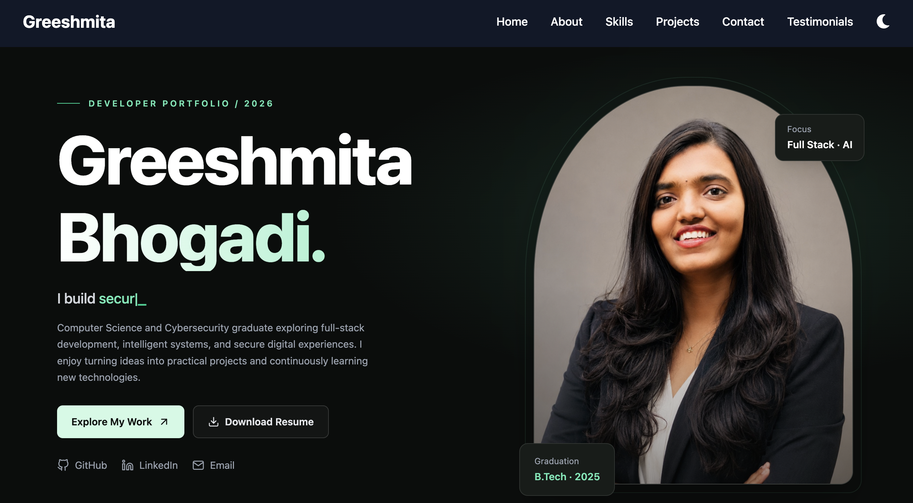
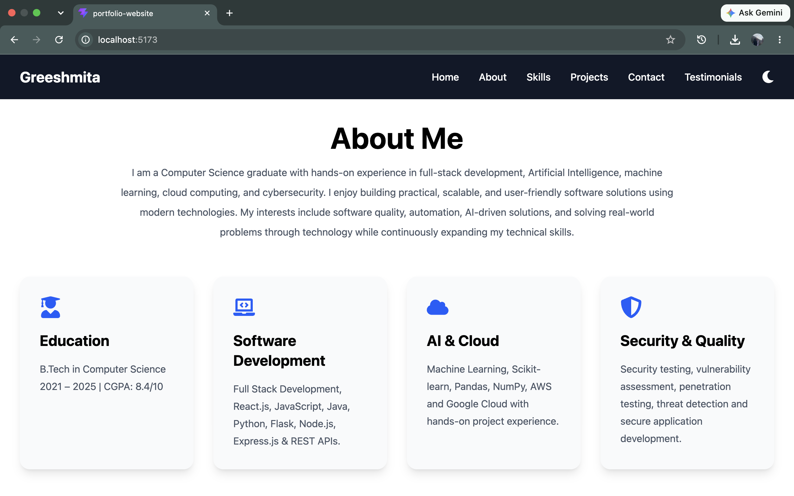
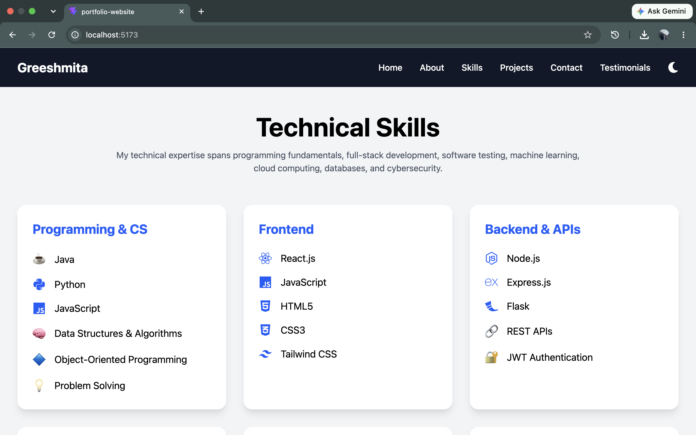
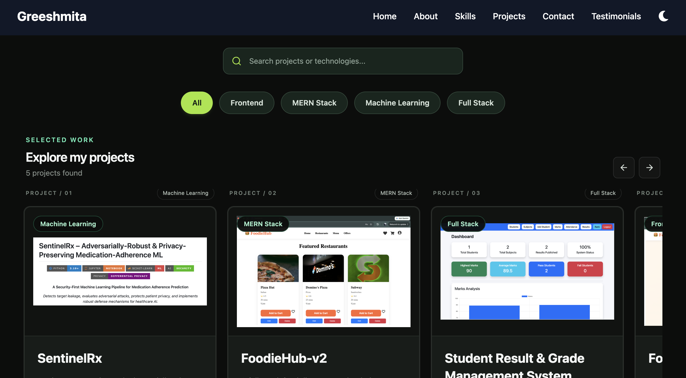
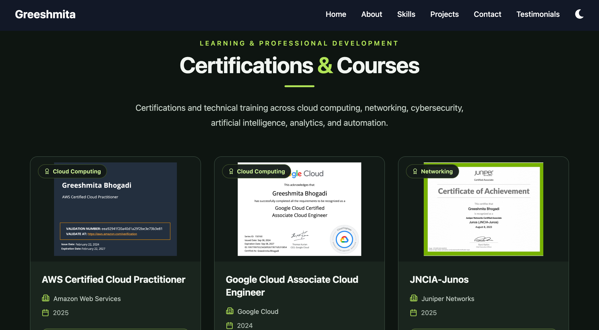
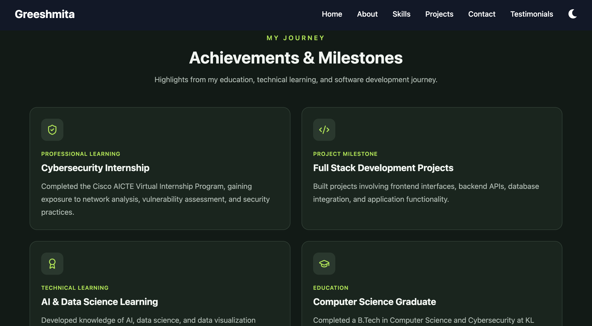
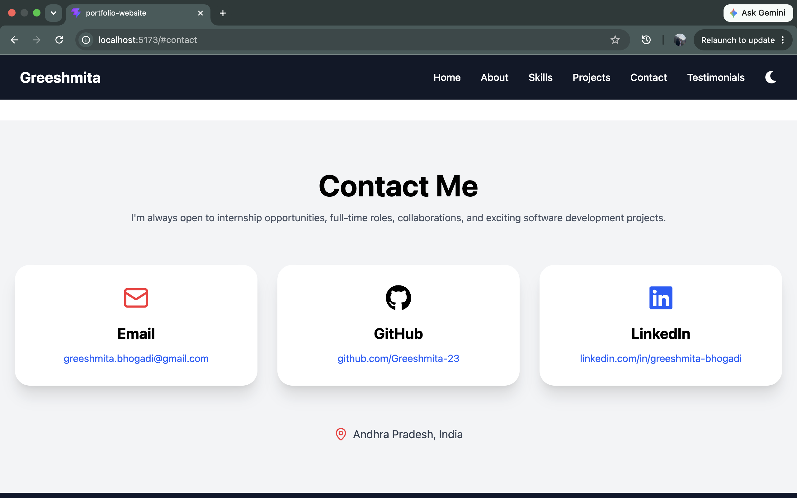

# 🌐 Greeshmita Bhogadi | Personal Portfolio Website

<div align="center">


### A modern, responsive portfolio showcasing my projects, technical skills, and professional journey.

Built with **React.js, Vite, Tailwind CSS, and Framer Motion**.

[🌐 Live Portfolio](https://portfolio-website-chi-flame-86.vercel.app/) · [💻 GitHub Repository](https://github.com/Greeshmita-23/portfolio-website) · [💼 LinkedIn](https://www.linkedin.com/in/greeshmita-bhogadi/)

</div>

---

## 📖 About the Project

This is my personal developer portfolio, created to showcase my background in Computer Science and Cybersecurity, technical skills, projects, certifications, and professional interests.

The website features a responsive interface, smooth animations, project showcases, GitHub integration, and convenient access to my resume and contact information.

It serves as a central place for recruiters, developers, and collaborators to explore my work and connect with me.

## 🌐 Live Demo

**Explore the portfolio:**  
🔗 https://portfolio-website-chi-flame-86.vercel.app/

---

## 📸 Portfolio Preview

The screenshots below showcase the main sections of the portfolio. Make sure the image paths match the actual filenames in your `screenshots/` folder.

### 🏠 Home



### 👤 About



### 🛠️ Skills



### 🚀 Projects



### 🏆 Certifications



### 🎯 Achievements



### 📩 Contact



---

## ✨ Features

- 🎨 Modern, clean, and responsive user interface
- 📱 Mobile-friendly layout
- 🌙 Dark and light mode
- ⚡ Fast development and production builds with Vite
- 🎭 Smooth animations using Framer Motion
- 👋 Professional introduction and hero section
- 👤 About me and technical interests
- 🛠️ Technical skills showcase
- 💼 Experience and professional journey
- 🏆 Certifications and achievements sections
- 🚀 Featured projects with project details
- 📊 GitHub statistics and repository links
- 📄 Resume access and download
- 📬 Contact section
- 🔗 Social and professional profile links

---

## 🛠️ Tech Stack

### Frontend
- React.js
- JavaScript (ES6+)
- Vite
- HTML5

### Styling
- Tailwind CSS
- CSS3

### Libraries
- Framer Motion
- React Icons
- Lucide React

### Development Tools
- Visual Studio Code
- Git
- GitHub
- npm

### Deployment
- Vercel

---

## 📂 Project Structure

```text
portfolio-website/
├── public/
│   ├── profile.png
│   ├── resume.pdf
│   └── favicon.svg
├── screenshots/
│   ├── home.png
│   ├── about.png
│   ├── skills.png
│   ├── projects.png
│   ├── certificates.png
│   ├── achievements.png
│   └── contact.png
├── src/
│   ├── assets/
│   │   ├── images/
│   │   └── certificates/
│   ├── components/
│   │   ├── Navbar.jsx
│   │   ├── Hero.jsx
│   │   ├── About.jsx
│   │   ├── Skills.jsx
│   │   ├── Experience.jsx
│   │   ├── Certificates.jsx
│   │   ├── Achievements.jsx
│   │   ├── Projects.jsx
│   │   ├── GitHubProjects.jsx
│   │   ├── GithubStats.jsx
│   │   ├── Resume.jsx
│   │   ├── Contact.jsx
│   │   └── Footer.jsx
│   ├── App.jsx
│   ├── main.jsx
│   └── index.css
├── index.html
├── package.json
├── package-lock.json
└── README.md
```

*Note: This is an illustrative structure. Adjust it to match the files and folders in your actual repository.*

---

## ⚙️ Getting Started

Follow these steps to run the portfolio locally.

### Prerequisites

Install the following before starting:

- [Node.js and npm](https://nodejs.org/)
- [Git](https://git-scm.com/)
- A code editor such as [Visual Studio Code](https://code.visualstudio.com/)

### 1. Clone the Repository

```bash
git clone https://github.com/Greeshmita-23/portfolio-website.git
```

### 2. Navigate to the Project Folder

```bash
cd portfolio-website
```

### 3. Install Dependencies

```bash
npm install
```

### 4. Start the Development Server

```bash
npm run dev
```

Open the local URL displayed in your terminal, usually `http://localhost:5173/`.

### 5. Create a Production Build

```bash
npm run build
```

Vite generates the production-ready files in the `dist/` directory.

### 6. Preview the Production Build

```bash
npm run preview
```

Use the local URL shown in your terminal to check the production build.

---

## 🚀 Deployment